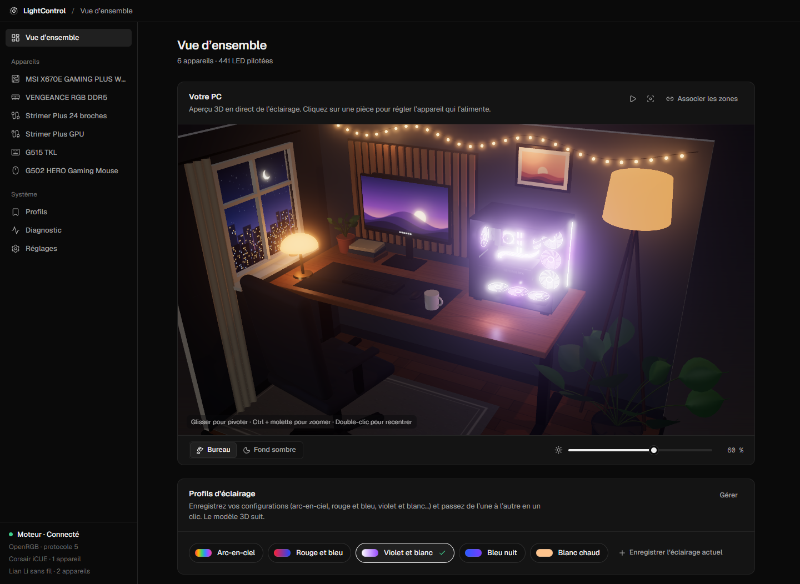
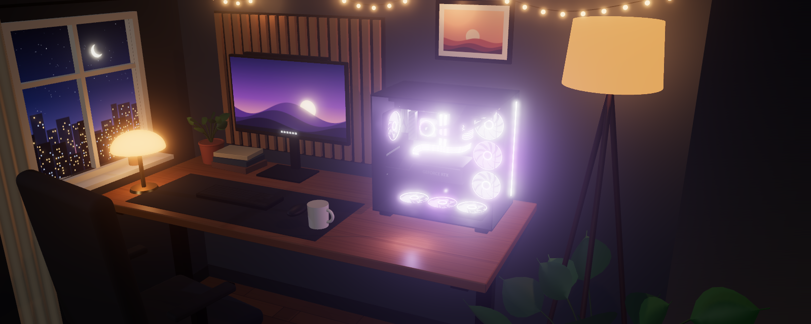
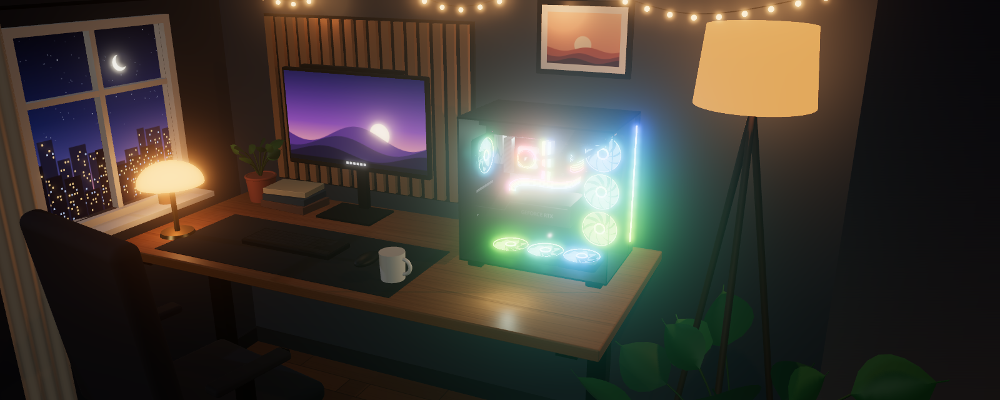
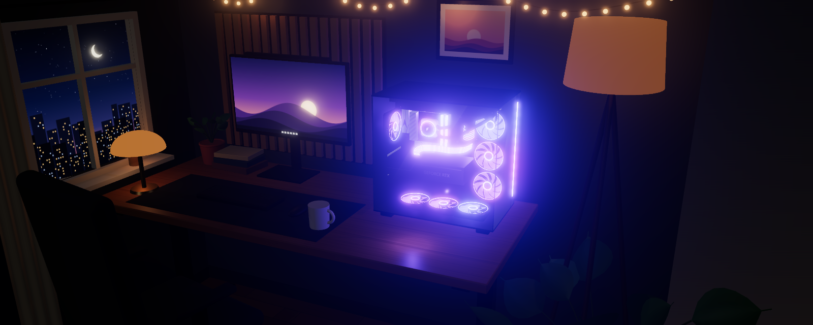
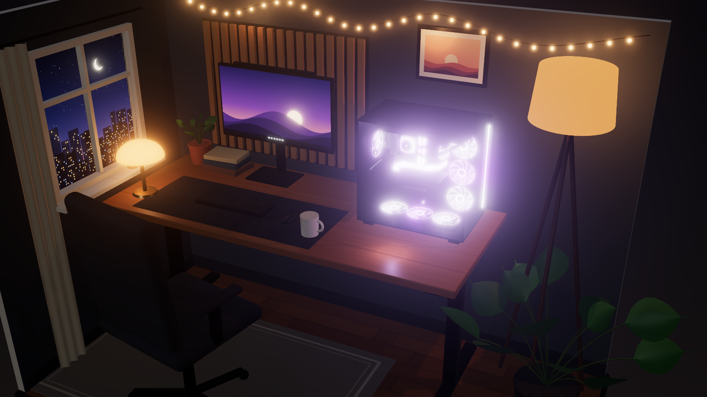
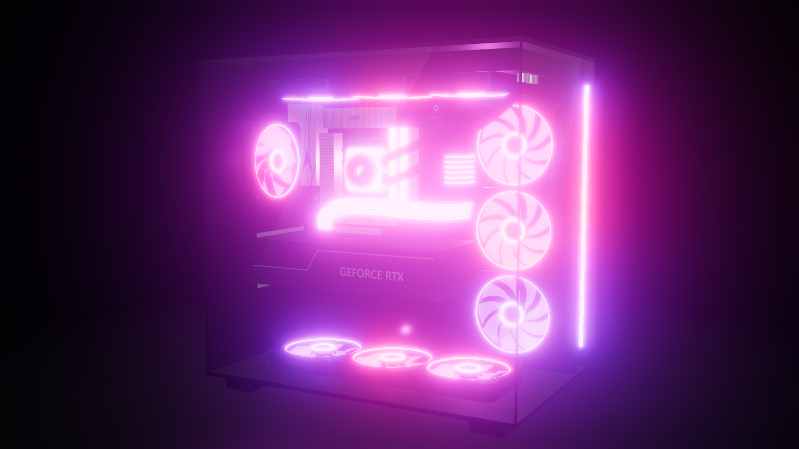
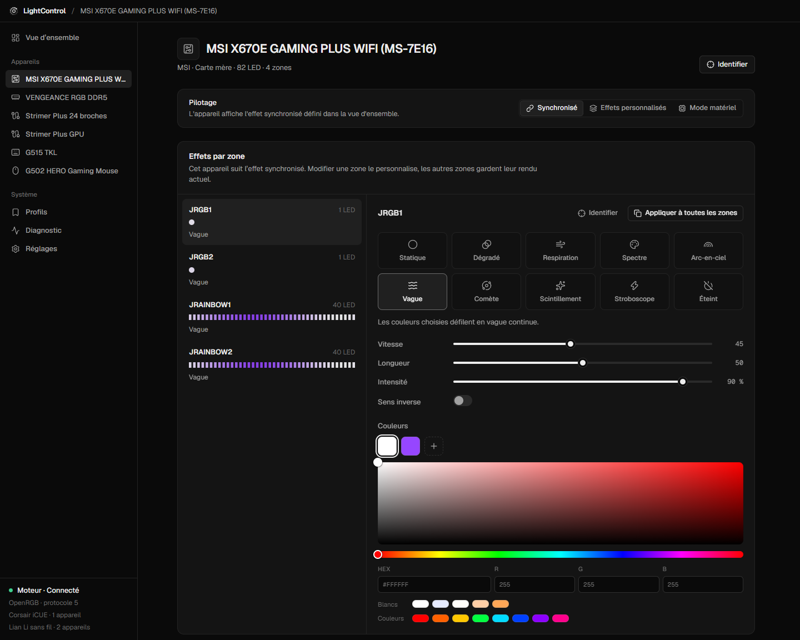
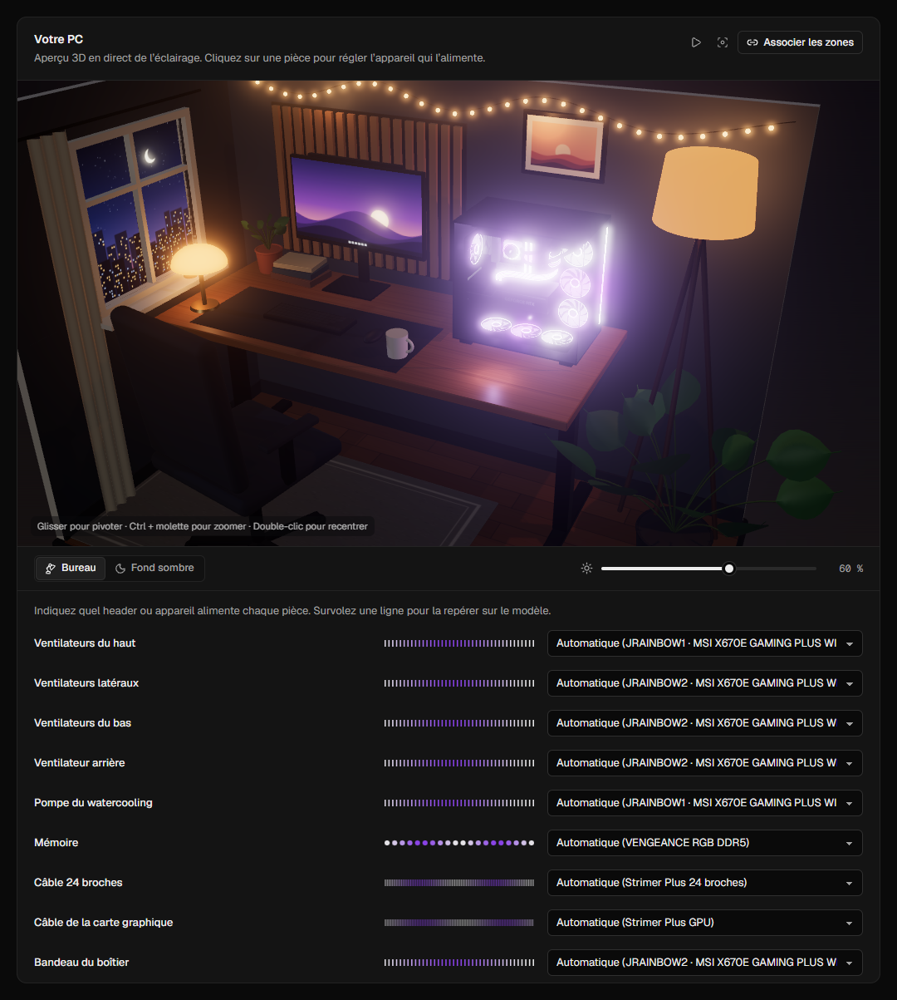
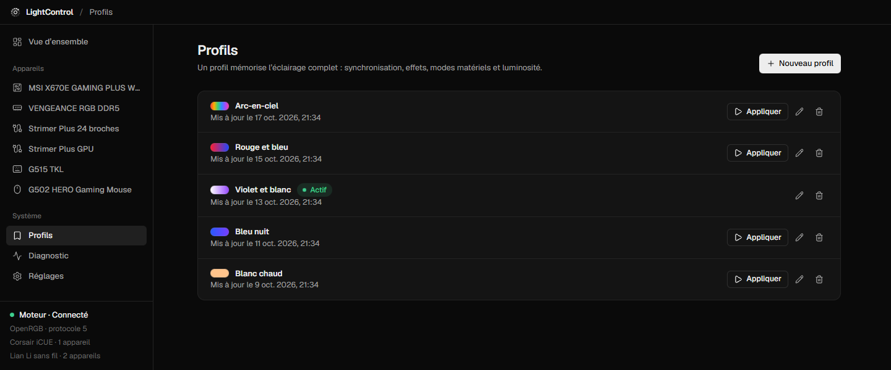
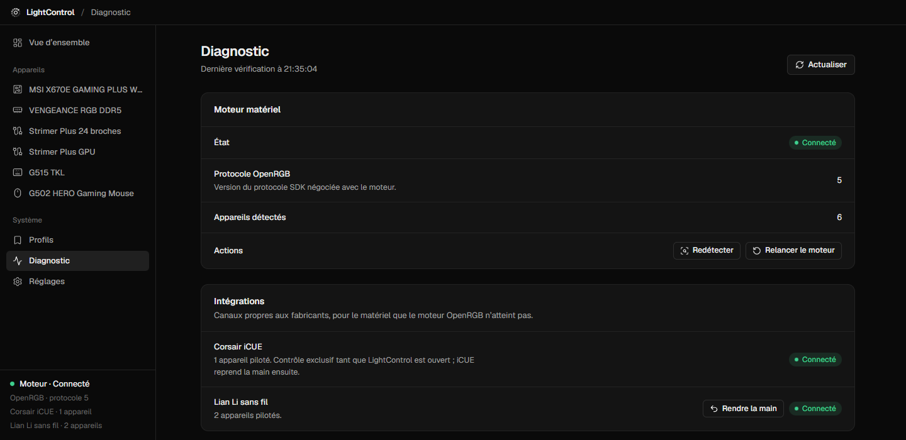

# LightControl



Application Windows qui pilote tout l’éclairage RGB d’un PC depuis une seule interface : carte mère et ses headers ARGB (AIO, ventilateurs, bandeaux), mémoire, périphériques et câbles Lian Li sans fil. Un seul effet peut être synchronisé sur tout le PC, ou un effet différent réglé zone par zone.

Construite avec Electron, TypeScript et React. Aucun service ni pilote supplémentaire n’est installé.

- **Trois canaux matériels réunis** : moteur OpenRGB embarqué, SDK Corsair iCUE et protocole sans fil Lian Li, derrière la même interface.
- **Effets logiciels** synchronisés sur tout le PC ou réglés zone par zone, ou effets matériels intégrés à chaque appareil.
- **Modèle 3D du PC** qui reprend en direct les couleurs envoyées au matériel, posé dans une maquette de bureau en soirée.
- **Profils d’éclairage** appliqués en un clic, depuis l’application ou la zone de notification.

> Projet indépendant, sans lien avec MSI, Corsair, Lian Li, Logitech ou OpenRGB. Les noms de produits appartiennent à leurs propriétaires.

## Aperçu

La maquette suit l’éclairage réel du PC ; sa lumière se règle de la nuit noire à une soirée éclairée.

| Soirée                                                                          | Arc-en-ciel                                                                 | Nuit                                                             |
| ------------------------------------------------------------------------------- | --------------------------------------------------------------------------- | ---------------------------------------------------------------- |
|  |  |  |

| Maquette complète                                                            | Fond sombre                                                            |
| ---------------------------------------------------------------------------- | ---------------------------------------------------------------------- |
|  |  |

| Effets par zone                                                                             | Association des zones                                                                              |
| ------------------------------------------------------------------------------------------- | -------------------------------------------------------------------------------------------------- |
|  |  |

| Profils                                                         | Diagnostic                                                                        |
| --------------------------------------------------------------- | --------------------------------------------------------------------------------- |
|  |  |

Captures de l’interface réelle, alimentée par des données de démonstration calquées sur la machine de test.

## Matériel pris en charge

LightControl combine trois canaux matériels derrière une même interface :

| Canal                              | Matériel                                                                                      | Fonctionnement                                                                                                                                          |
| ---------------------------------- | --------------------------------------------------------------------------------------------- | ------------------------------------------------------------------------------------------------------------------------------------------------------- |
| [OpenRGB](https://openrgb.org) 1.0 | Cartes mères (headers RGB 12 V et ARGB 5 V), claviers, souris et la plupart des périphériques | Moteur embarqué, lancé en arrière-plan et limité à `127.0.0.1`. LightControl lui parle via son protocole SDK (version 5), avec un client écrit de zéro. |
| SDK Corsair iCUE                   | Appareils déjà gérés par iCUE (mémoire Vengeance RGB…)                                        | Runtime officiel, chargé dans un processus isolé. Il demande le contrôle exclusif de l’éclairage tant que LightControl est ouvert.                      |
| Lian Li 2,4 GHz                    | Strimer Plus Wireless, UNI FAN Wireless, HydroShift II…                                       | Protocole sans fil réimplémenté, accès au dongle USB via libusb dans un processus isolé.                                                                |

Matériel validé sur une vraie machine : carte MSI X670E (Mystic Light USB), AIO et ventilateurs Corsair sur headers ARGB, mémoire Corsair Vengeance RGB DDR5, Logitech G502 et G515, Lian Li Strimer Plus Wireless (24 broches et GPU).

## Fonctionnalités

### Éclairage

- **Synchronisation globale** : un effet unique pour tout le PC, en phase, avec interrupteur et luminosité générale.
- **Effets par zone** : statique, dégradé, respiration, spectre, arc-en-ciel, vague, comète, scintillement, stroboscope. LightControl les calcule et les diffuse à 30 images/s (réglable de 10 à 60). Sur les claviers, ils suivent la disposition physique des touches.
- **Modes matériels** : les effets intégrés à chaque appareil (vitesse, luminosité, direction, couleurs). Ils peuvent être enregistrés dans l’appareil pour rester actifs sans LightControl.
- **Headers ARGB** : nombre de LED réglable header par header. Pendant le réglage, la dernière LED s’allume en rouge pour aider à compter.
- **Balance des blancs** par appareil, avec test en direct. Elle corrige le blanc jaunâtre des longues chaînes ARGB.
- **Appareils sans fil Lian Li** : chaque effet est pré-calculé sur une boucle complète et compressé pour tenir dans la mémoire de l’appareil. L’appareil confirme l’animation reçue, puis la rejoue seul, même LightControl fermé. Ces appareils oublient leur appairage quand le PC est éteint : comme L-Connect, LightControl ré-appaire à chaque démarrage ceux de votre liste d’appairage, et aucun autre.

### Modèle 3D du PC

- **Aperçu en direct** sur la vue d’ensemble : boîtier, ventilateurs, pompe, mémoire, câbles Strimer et bandeau reprennent les couleurs envoyées au matériel, avec leur halo et la lumière qu’ils projettent dans le boîtier. Glisser pour pivoter, Ctrl + molette pour zoomer, double-clic pour recentrer. Un clic sur une pièce ouvre l’appareil qui l’alimente.
- **Maquette ou fond sombre** : le PC est posé sur un bureau en soirée (lampes chaudes, guirlande, fenêtre sur la ville la nuit), ou isolé sur un fond sombre. Le curseur « Luminosité de la scène » règle la lumière de la pièce sans toucher à celle des LED.
- **Association des zones** : chaque pièce est associée automatiquement à un header ou un appareil. Pompe et ventilateurs du haut vont sur le premier header ARGB, les autres ventilateurs et le bandeau sur le second, la mémoire et les câbles Strimer sur leur appareil ; un AIO ou des ventilateurs pilotés directement passent avant les headers. « Associer les zones » corrige chaque pièce, l’éteint ou la remet en automatique.
- **Sobre** : le rendu se met en pause quand le modèle n’est pas à l’écran ou que la fenêtre est masquée. Le modèle peut être retiré de la vue d’ensemble dans Réglages › Rendu.

### Profils et diagnostic

- **Profils** : un profil mémorise l’éclairage complet (synchronisation, effets, modes matériels, luminosité). La vue d’ensemble les affiche sous le modèle 3D avec un aperçu de leurs couleurs : un clic applique un profil, et le modèle suit. Si l’éclairage change ensuite, LightControl propose de mettre le profil à jour. Les profils restent applicables depuis la zone de notification.
- **Diagnostic** : état des moteurs et intégrations, logiciels concurrents actifs (MSI Mystic Light, G HUB, L-Connect…), matériel détecté mais non pilotable.

## Installation

Windows 10 ou 11, 64 bits. Lancer `LightControl-Setup-<version>.exe` (installation par utilisateur, sans droits administrateur), puis activer « Lancer au démarrage » dans les réglages pour que l’éclairage soit rétabli à chaque démarrage du PC.

Selon le matériel :

- **MSI** : dans MSI Center › Fonctionnalités, désinstaller Mystic Light. Sinon, il réapplique ses couleurs au démarrage et en sortie de veille.
- **Corsair** : laisser iCUE ouvert et activer son SDK dans ses réglages.
- **Lian Li sans fil** : L-Connect 3 garde le dongle pour lui. Dans Diagnostic › Intégrations, « Prendre le contrôle » arrête ses services, les passe en démarrage manuel et désactive son lancement avec Windows. « Rendre la main » les rétablit à l’identique. Chaque opération demande une confirmation administrateur ; rien n’est désinstallé et le firmware n’est jamais modifié. Pour appairer un nouvel appareil Lian Li : rendre la main, l’appairer dans L-Connect, puis reprendre le contrôle.

## Prise en main

1. Au premier lancement, le moteur détecte le matériel en quelques secondes ; les appareils apparaissent dans la barre latérale.
2. Sur la page de la carte mère, indiquer le nombre de LED de chaque header ARGB. Tant qu’un header n’est pas réglé, il pilote 40 LED par défaut.
3. Dans la vue d’ensemble, choisir l’effet synchronisé, ou ouvrir un appareil pour lui donner ses propres effets, zone par zone.
4. Vérifier sur le modèle 3D que chaque pièce s’allume comme le vrai PC ; sinon, corriger avec « Associer les zones ».
5. Enregistrer l’éclairage obtenu avec « Enregistrer l’éclairage actuel », puis passer d’un profil à l’autre en un clic.

## Développement

Prérequis : Node.js 22 ou plus récent, Windows.

| Commande                             | Rôle                                                                                                                                      |
| ------------------------------------ | ----------------------------------------------------------------------------------------------------------------------------------------- |
| `npm install`                        | Installe les dépendances et télécharge OpenRGB et le runtime iCUE dans `vendor/`                                                          |
| `npm run dev`                        | Lance l’application en développement, avec rechargement à chaud de l’interface                                                            |
| `npm run dist`                       | Produit l’installateur `release/<version>/LightControl-Setup-<version>.exe`                                                               |
| `npm run test`                       | Tests unitaires : protocoles OpenRGB et Lian Li, compression, effets, planificateur, moteur, profils, association des pièces du modèle 3D |
| `npm run typecheck` / `npm run lint` | Vérification des types et ESLint                                                                                                          |

Tests optionnels sur matériel réel, désactivés par défaut :

```sh
OPENRGB_LIVE=127.0.0.1:6742 npx vitest run client.live        # serveur OpenRGB en marche, lecture seule
LIANLI_LIVE=1 npx vitest run wireless.live                     # appareils Lian Li appairés, lecture seule
LIANLI_UPLOAD=255,0,0 npx vitest run wireless-upload.live      # couleur fixe envoyée aux appareils Lian Li
```

Les tests Lian Li ont besoin du dongle libre : LightControl et L-Connect doivent être fermés.

## Architecture

```
src/
  shared/              Contrat commun : schémas Zod, modèle du domaine, effets, canaux IPC
  main/                Processus principal, sans dépendance à l'interface
    app/               Racine de composition et façade de l'application
    hardware/          Port HardwareBackend, hub qui combine les backends
      openrgb/         Client du protocole SDK, codec binaire, supervision du processus
      icue/            Hôte isolé (utilityProcess + koffi) et backend avec chien de garde
      lianli/          Protocole RF, compression tinyuz, liaison libusb, hôte isolé
    lighting/          Rendu des effets, couleurs, planificateur (fonction pure), moteur
    services/          État d'éclairage, réglages, profils, diagnostic
    system/            Requêtes Windows, passage de main avec L-Connect 3
    ipc/, security/, windows/
  preload/             Pont contextBridge minimal
  renderer/src/        Interface React : composants, pages, état (zustand)
    features/pc-model/ Modèle 3D : association des pièces, PC et maquette procéduraux, rendu three.js
```

Le moteur d’éclairage ne connaît que le port `HardwareBackend`. Pour ajouter une technologie matérielle, il suffit de l’implémenter : moteur, services et interface restent inchangés. Les appareils qui ne reçoivent pas d’images en continu (le sans-fil) se déclarent en livraison « boucle ». Le moteur leur envoie alors une animation complète à chaque changement.

Le modèle 3D ne demande rien de plus au processus principal : il lit l’aperçu des LED déjà envoyé à l’interface (20 fois par seconde, seulement quand la fenêtre est visible) et lisse les couleurs entre deux aperçus. Géométries et textures sont générées au démarrage, sans fichier externe, et three.js n’est chargé qu’à l’affichage du modèle.

## Sécurité

- **Interface** : fenêtre en bac à sable, isolation de contexte, aucune API Node dans l’interface. CSP stricte ; navigation, nouvelles fenêtres et permissions bloquées.
- **IPC** : chaque canal vérifie l’expéditeur et valide sa charge avec Zod. Les erreurs internes ne sont jamais renvoyées telles quelles.
- **Exécutable** : interface servie par un protocole `app://` privilégié. Fusibles Electron : pas de `RunAsNode`, intégrité de l’archive ASAR, `file://` sans privilèges.
- **Code natif isolé** : les bibliothèques natives (iCUE, libusb) tournent dans des processus utilitaires séparés. Un plantage ou un blocage n’y atteint pas l’application.
- **Réseau et droits** : serveur OpenRGB lié à `127.0.0.1`, liens externes limités à une liste de domaines. Les seules opérations privilégiées sont des scripts fixes, lancés après confirmation Windows.

## Crédits et licences tierces

- **OpenRGB** (GPL-2.0) : programme séparé, livré tel quel et piloté uniquement par son protocole réseau.
- **libusb** (LGPL-2.1) : bibliothèque livrée avec OpenRGB.
- **Corsair iCUE SDK** : le runtime redistribuable officiel.
- **[lian-li-linux](https://github.com/sgtaziz/lian-li-linux)** (MIT) : le protocole Lian Li est réimplémenté d’après ce projet.
- **[tinyuz](https://github.com/sisong/tinyuz)** (MIT) : le format de compression vient de ce projet.
- **[three.js](https://threejs.org)** (MIT) : rendu du modèle 3D.

Textes et détails : [THIRD_PARTY_NOTICES.md](THIRD_PARTY_NOTICES.md).
